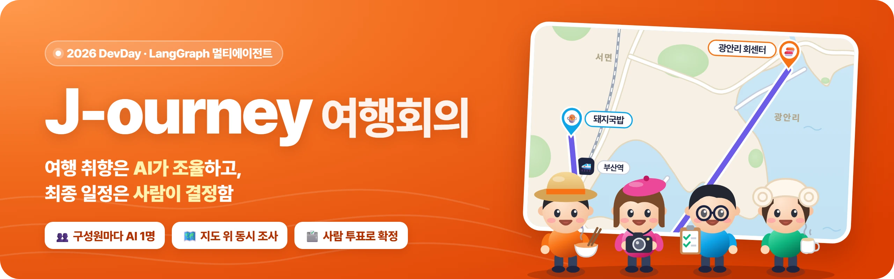
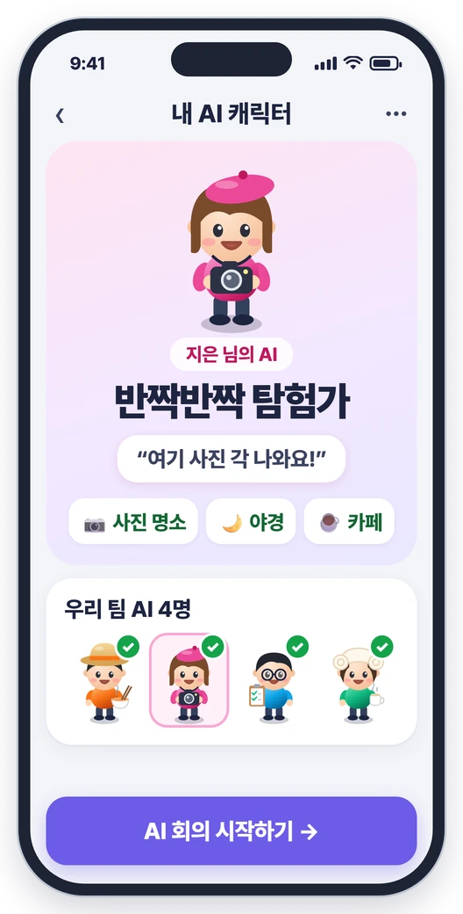
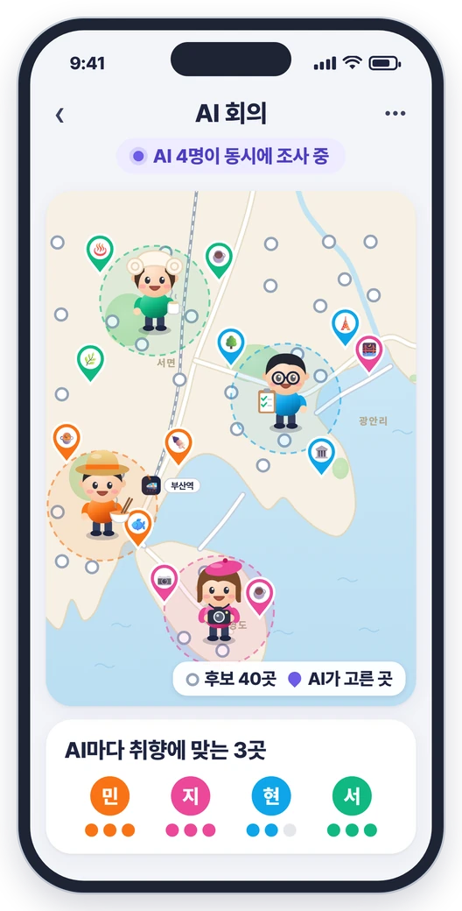
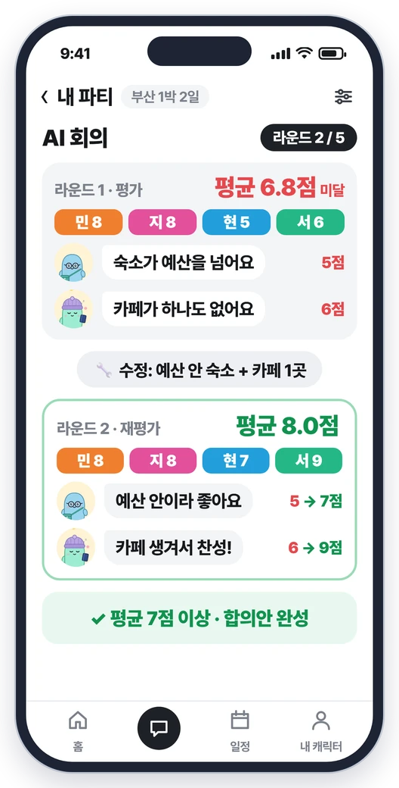
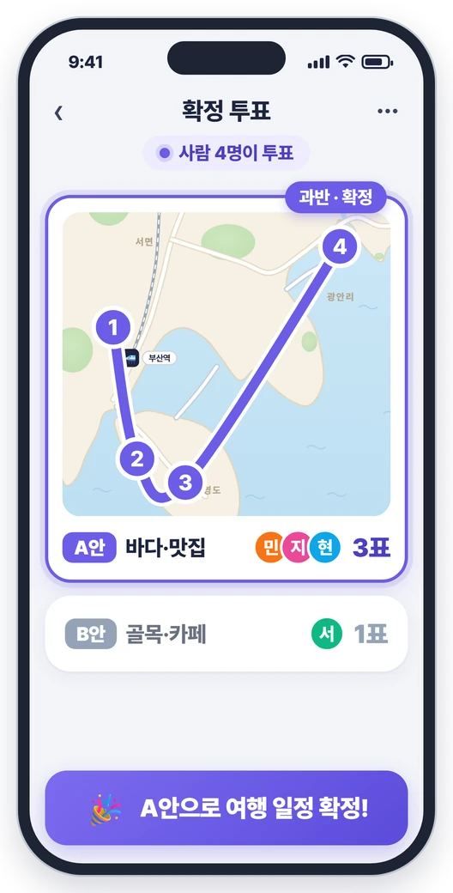
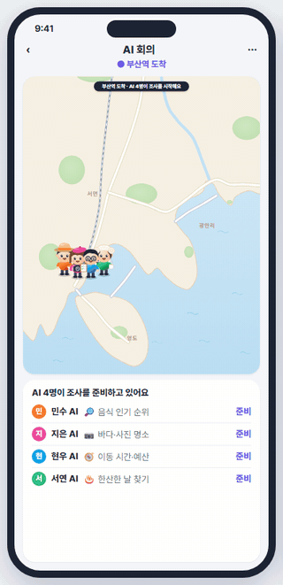
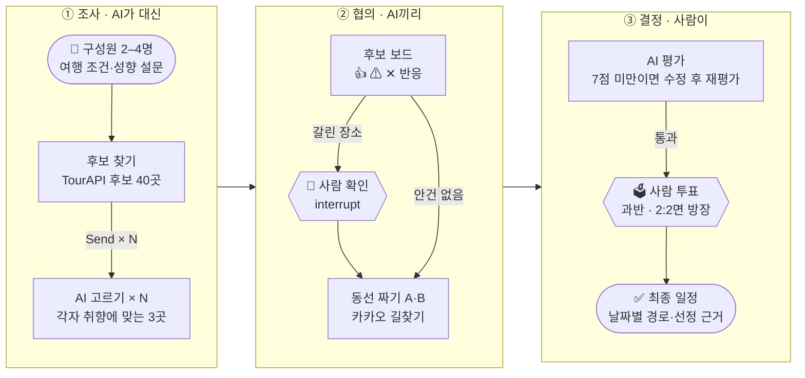

<div align="center">



<br>

**구성원마다 성향을 담은 AI가 대신 회의하고, 사람은 갈린 안건과 최종안만 투표하는 단체 여행 플래너**

<p>
  <a href="LICENSE"></a>
  
  
  <a href="https://github.com/gokimkh123/J-ourney/actions/workflows/ci.yml"></a>
</p>

<p>
  
  
  
  
  
  
  
  
</p>

<a href="#1-소개">소개</a> · <a href="#2-미리보기">미리보기</a> · <a href="#3-동작-구조">동작 구조</a> · <a href="#4-화면-id">화면 ID</a> · <a href="#5-기술-스택">기술 스택</a> · <a href="#6-시작하기">시작하기</a>

</div>

## 1. 소개

> **문제** 단체 여행은 한 명이 조사·조율을 떠안고, 취향이 달라 결정이 어려움<br>
> **해결** LangGraph 멀티에이전트로 구성원마다 AI가 대신 회의하고, 갈린 안건과 최종안만 사람이 투표함

<table>
  <tr>
    <th width="25%">① 나를 대신하는 AI</th>
    <th width="25%">② 동시에 조사하는 AI</th>
    <th width="25%">③ AI끼리 협의·재평가</th>
    <th width="25%">④ 결정은 사람 투표</th>
  </tr>
  <tr>
    <td align="center"></td>
    <td align="center"></td>
    <td align="center"></td>
    <td align="center"></td>
  </tr>
  <tr>
    <td>15문항 성향 설문으로 구성원마다 AI 1명 생성</td>
    <td>지도 위 후보 40곳에서 AI마다 취향에 맞는 3곳 선정</td>
    <td>AI 예상 만족도 7점 미만이면 수정 후 재평가 (최대 5라운드)</td>
    <td>AI가 합의한 일정안(A안·B안) 중 사람이 과반 투표로 확정</td>
  </tr>
</table>

- 성향 설문(15문항) 응답으로 구성원별 캐릭터 카드(AI)를 만듦
- 공공 관광 데이터(한국관광공사 TourAPI·관광 빅데이터)로 찾은 후보 장소를 AI가 동시에 고르고, 공용 후보 보드에서 👍·⚠·✕로 의견을 나눔
- 의견이 갈리는 장소는 사람이 남길지 뺄지 정함
- 코드가 동선·식당·가는 길(카카오 길찾기)을 계산해 일정안 2개(A안·B안)를 짜고, AI가 평가와 수정을 반복함
- 사람이 투표로 하나를 고르며(과반, 2:2면 방장), 추천 항목마다 선정 근거와 지도 링크를 제공함
- 화면 속 수치는 설명용 예시임

## 2. 미리보기

<div align="center">
  
</div>

- 부산역 출발 → 각자 조사 → 공용 후보 보드 → 회의 탁자 → 일정안 경로 → AI 합의안 (화면 속 수치는 설명용 예시)

## 3. 동작 구조



| LangGraph 기능 | 회의에서 하는 일 |
| --- | --- |
| StateGraph | 회의 단계를 하나의 그래프로 연결하고 흐름을 제어함 |
| Send · Subgraph | 구성원 수(N)만큼 AI를 만들어 동시에 실행함 |
| Reducer | AI별 결과를 공용 후보 보드로 합침 |
| Conditional Edge | 갈린 안건이 있을 때만 사람 확인으로 보냄 |
| Cycle | AI 예상 만족도 7점 미만이면 수정 후 재평가함 (최대 5라운드) |
| interrupt | 사람 확인·투표 동안 멈췄다가 결과를 받아 이어 감 |

| 원칙 | 맡는 일 |
| --- | --- |
| 🧠 판단은 LLM | 성향 카드, 장소 고르기, 사람이 쓴 바람과 장소 소개글 대조, 일정안 평가 |
| 🧮 계산·검증은 코드 | 후보 점수, 동선·식당·가는 길, 호출 상한, LLM 답의 근거 확인 |
| 🙋 최종 결정은 사람 | 갈린 장소 남김·뺌, A안·B안 투표 |

- 회의 엔진은 LangGraph StateGraph로 만들며, 상태를 PostgreSQL 체크포인트에 저장해 사람 확인에서 멈춘 지점부터 이어 감
- 회의 진행 이벤트는 WebSocket으로 앱 지도에 바로 보냄
- 회의 엔진은 15단계로 설계했으며 단계마다 구현·검수함

### 비용 설계

| 항목 | 내용 |
| --- | --- |
| 여행 1건 LLM 비용 | 약 7원 (시험 버전으로 여행 300건 실측, 평균 약 $0.005, 성향 카드 4장과 회의 전체 포함) |
| 프롬프트 엔지니어링 | 꼭 필요한 판단만 LLM에 맡기고 계산·검증은 코드가 함 |
| 프롬프트 캐싱 | 반복되는 지시문을 캐시해 1–4단계 비용을 48% 줄임 (여행당 $0.0066 → $0.0034) |
| 호출 상한 | 회의·하루 단위 상한을 넘거나 실패하면 규칙 기반으로 대신함 |
| 외부 API | 무료 범위만 사용하며, 같은 길찾기 구간은 7일 동안 다시 씀 |

### 저장소 구성

| 폴더 | 내용 | 담당 |
| --- | --- | --- |
| `server/` | 백엔드·AI 서버 (Node.js 24, TypeScript, Hono) | 김건한 |
| `app/` | 모바일 앱 (Expo, React Native) | 전규민 |
| `.github/` | CI/CD (GitHub Actions), PR 템플릿 | 김건한 |

- 작업 흐름: `server/setup`·`app/setup`에서 작업 → develop 대상 PR (CI 통과 필수) → main 병합 시 서버 이미지를 GHCR에 저장
- 보안: 저장소를 받은 뒤 최상위 폴더에서 `git config core.hooksPath .githooks`를 한 번 실행하며, 비밀값은 저장소에 커밋하지 않음
- 요구사항·연동 명세서와 동작 흐름 예시는 팀 내부 문서로 별도 공유함

## 4. 화면 ID

| ID | 화면 | 범위 |
| --- | --- | --- |
| A1 | 초대 받기 | 필수 |
| A2 | 성향 질문 | 필수 |
| A3 | 페르소나 카드 | 필수 |
| A4 | 팀 궁합 | 선택 |
| B1 | 회의 조건 | 필수 |
| B1-1 | 여행지 추천 | 선택 |
| B2 | 회의 진행 | 필수 |
| B3 | AI 합의안 | 필수 |
| B4 | 확정 투표 | 필수 |
| C1 | 합의 일정 | 필수 |
| C2 | 근거 보기 | 필수 |
| C3 | 수정안 비교 | 필수 |
| C4 | 확정·예약 | 제외 |
| D1 | 기상 알림 | 선택 |
| D2 | 대안 투표 | 선택 |
| D3 | 정산 | 제외 |
| D4 | 여행 평가 | 제외 |

## 5. 기술 스택

| 영역 | 기술 |
| --- | --- |
| AI |    -8E75B2?logo=googlegemini&logoColor=white) |
| 서버 |      |
| DB |   |
| 앱 |    |
| 데이터 | 한국관광공사 TourAPI (관광지·음식점·숙소, 연관 관광지 순위, 집중률 예측) · 카카오 길찾기 (대중교통·자동차·도보) |
| CI/CD |    |

## 6. 시작하기

```bash
git clone https://github.com/gokimkh123/J-ourney.git
cd J-ourney
git config core.hooksPath .githooks       # 커밋 전 비밀값·개인정보 검사

cd server
npm ci && npm run typecheck && npm test   # PGlite·가짜 LLM으로 API 키 없이 시험
cp .env.example .env                      # API 키·POSTGRES_PASSWORD를 채움 (저장소에 커밋하지 않음)
docker compose up -d --build              # 서버·PostgreSQL·터널 실행
```

- 실행 방법·API·회의 엔진의 자세한 설명은 [server/README.md](server/README.md)에 있음
- 장소 정보 출처: ⓒ한국관광공사
